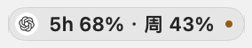
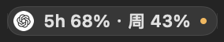
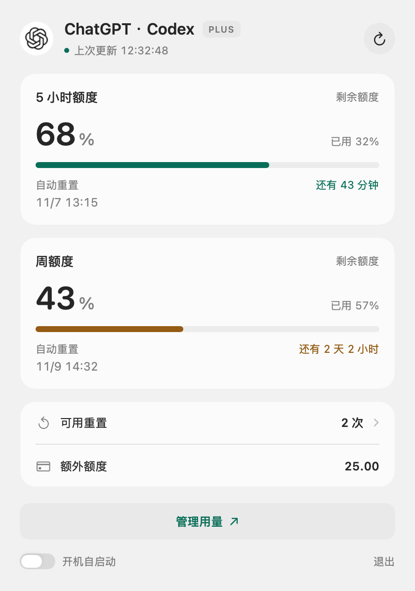
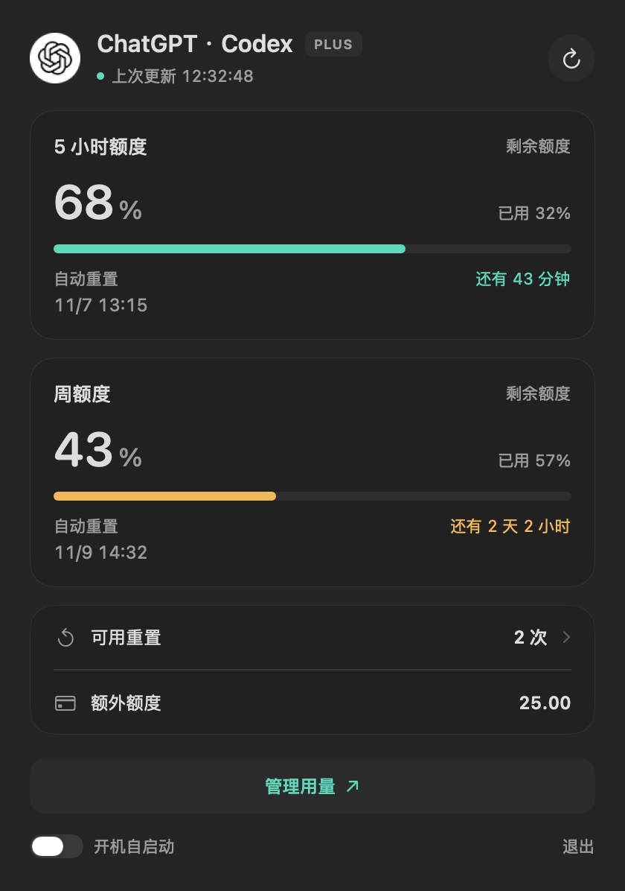

# GPT Monitor Bar

在 macOS 菜单栏查看 ChatGPT 套餐内的 Codex 额度。点开胶囊徽章可查看剩余比例、自动恢复倒计时、可用重置次数和到期时间。「管理用量」打开 [ChatGPT 使用情况页](https://chatgpt.com/settings/usage?tab=overview)。

## 界面预览

以下图片由当前原生 SwiftUI 视图离屏渲染，使用示例数据，并非运行中界面的屏幕截图。额度、更新时间和恢复时间以实际账户为准。

**菜单栏胶囊**

| 浅色 | 深色 |
| --- | --- |
|  |  |

**额度面板**

| 浅色 | 深色 |
| --- | --- |
|  |  |

面板支持展开重置明细，多组额度和较长内容可在中部滚动查看。深色使用固定石墨底色，避免浅色桌面背景将面板提亮。

## 右键菜单

右键点击胶囊可使用以下菜单：

```text
立即刷新
管理用量
选择 Codex CLI…
样式
  ├─ 浅色
  ├─ 深色
  └─ 跟随系统
退出
```

「样式」默认选择「跟随系统」，当前选项前显示勾选。切换后立即应用到胶囊和面板，并在下次启动时保留选择。

## 本地运行

需要 macOS 15 或更新版本、Swift 6 工具链，以及使用 ChatGPT 账号登录的 Codex CLI。

1. 如果尚未登录，运行 `codex login`。
2. 运行 `./make_app.sh`。
3. 在 Finder 双击 `dist/GPT Monitor Bar.app`。

应用会从 PATH、Homebrew 和 NVM 安装目录查找 Codex。如果未找到，点开面板选择本机的 `codex` 可执行文件。每分钟自动刷新，面板也提供手动刷新。

面板底部的「开机自启动」开关管理 macOS 登录项。若系统要求确认，可从面板进入「系统设置 → 通用 → 登录项」。胶囊中的 ChatGPT 图标来自 [ChatGPT 官网](https://chatgpt.com/)。

运行 `./run_tests.sh` 执行额度解析和模拟 App Server 测试。脚本会为 Command Line Tools 补充 Swift Testing 所需的框架路径。
